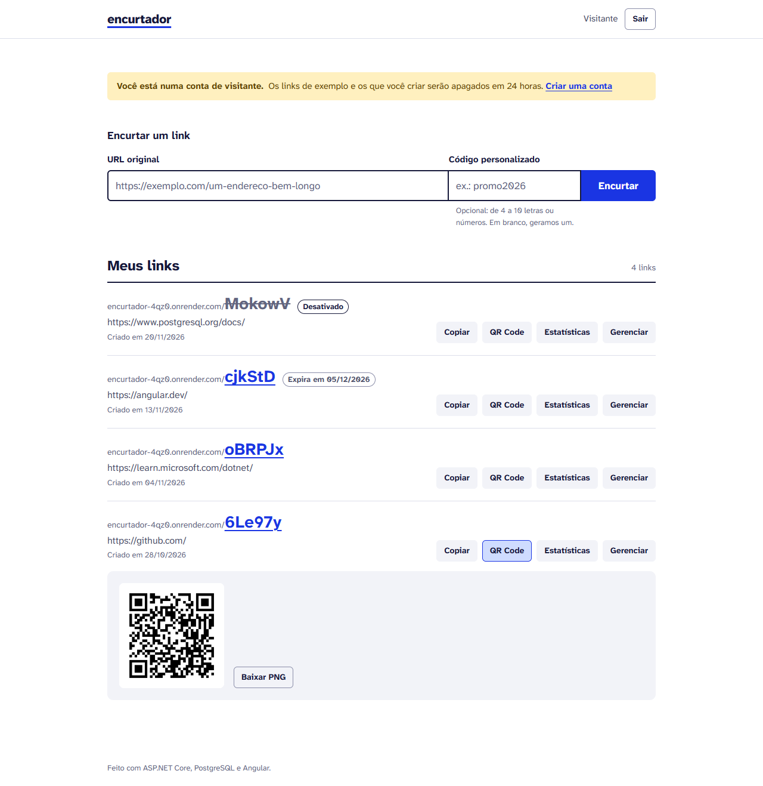
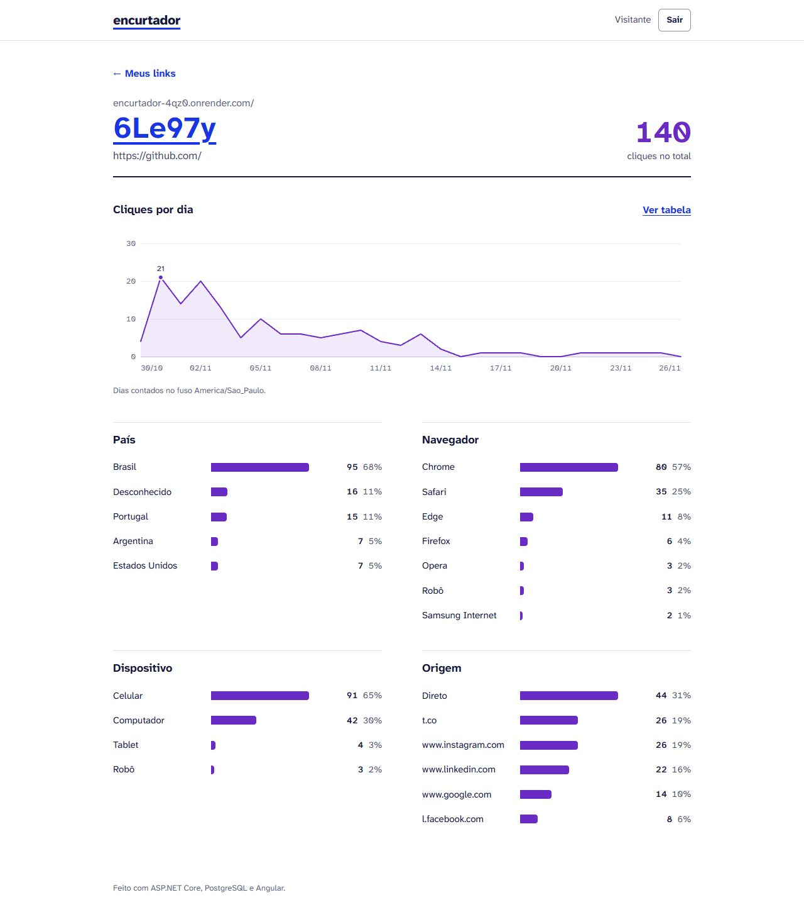
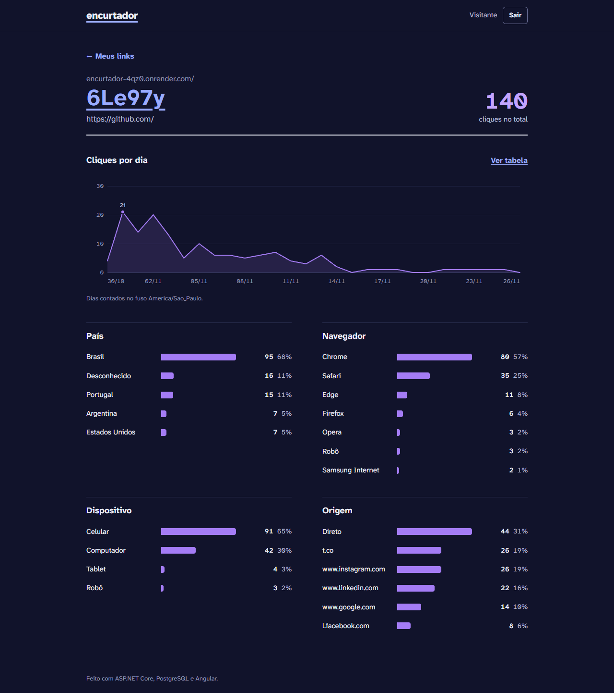
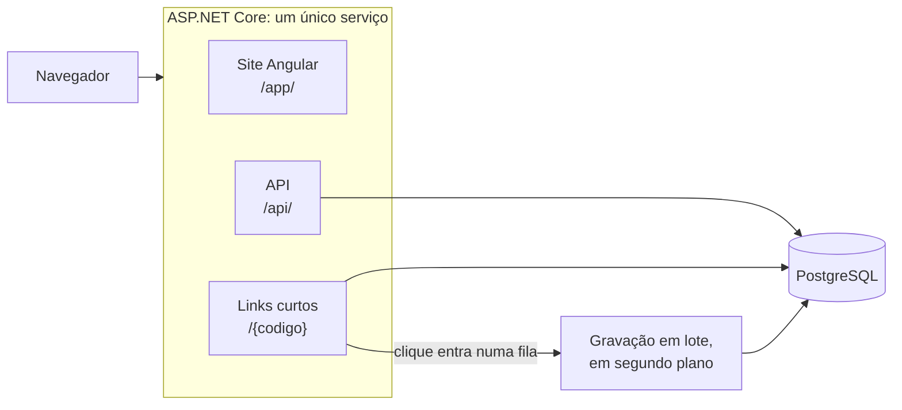

# Encurtador de URLs

[](https://github.com/izasd/encurtador-url/actions/workflows/ci.yml)

Encurtador de links com contas, estatísticas de cliques e QR Code, feito com **ASP.NET Core (.NET 10)**, **PostgreSQL** e **Angular**.

**Acesse: https://encurtador-4qz0.onrender.com**. Para testar sem criar conta, use **Entrar como visitante**: a conta já vem com links e cliques de exemplo e é apagada depois de 24 horas.

> A hospedagem é gratuita: depois de 15 minutos sem acesso o servidor dorme, e a primeira visita pode levar cerca de um minuto.



## O que dá para fazer

- Criar uma conta e entrar, ou entrar como visitante com dados de exemplo.
- Encurtar um link com código gerado (6 caracteres) ou personalizado (4 a 10 letras e números).
- Copiar o link curto, baixar o QR Code em PNG, desativar o link, definir uma data de expiração ou excluí-lo.
- Acompanhar os cliques por dia (no fuso horário de quem consulta), país, navegador, dispositivo e site de origem.



<details>
<summary>Tema escuro (segue a preferência do sistema)</summary>



</details>

## Como funciona



- **Um endereço só.** A API também serve o site Angular, em `/app/`, e a raiz fica para os links curtos. Como site e API estão no mesmo endereço, não é preciso CORS.
- **Redirecionamento rápido.** O redirecionamento só consulta o link e não espera a gravação do clique: o clique entra numa fila em memória, e um serviço em segundo plano grava os cliques em lote.
- **Códigos imprevisíveis.** Os códigos são gerados com `RandomNumberGenerator`. Um índice único no banco garante que duas requisições simultâneas nunca fiquem com o mesmo código.
- **Dias no fuso certo.** O PostgreSQL converte cada clique para o fuso horário pedido (`AT TIME ZONE`) antes de separar os dias: um clique às 23h em Brasília conta naquele dia, não no seguinte.
- **Cada um vê só o seu.** O login usa token JWT, e as senhas são guardadas com hash PBKDF2. Um link de outra pessoa responde `404`, como se não existisse; um link desativado ou expirado responde `410 Gone`.
- **Limites contra abuso.** São no máximo 30 links por minuto por usuário, 10 logins ou cadastros por minuto por IP e 10 contas de visitante por hora por IP. Acima disso a resposta é `429`, com o cabeçalho `Retry-After`.
- **Erros padronizados.** Todos os erros seguem o formato ProblemDetails (RFC 9457), com a mensagem de cada campo inválido.
- **Em produção,** o tráfego passa pelo Cloudflare: o IP do visitante (usado nos limites) vem do cabeçalho `CF-Connecting-IP`, e o país do clique, do `CF-IPCountry`.

## Tecnologias

| Parte | Tecnologia |
| --- | --- |
| API | ASP.NET Core Minimal APIs (.NET 10), autenticação JWT, rate limiting do próprio ASP.NET Core |
| Banco | PostgreSQL com Entity Framework Core 10 e migrations |
| Site | Angular 22 (componentes standalone e signals), gráficos em SVG feitos à mão |
| Testes | xUnit, Testcontainers (PostgreSQL de verdade em contêiner) e Vitest |
| Entrega | Docker, GitHub Actions e deploy no Render, com o banco no Neon |

## Como rodar

### Com Docker (um comando)

Precisa só do Docker:

```bash
docker compose up --build
```

O site abre em http://localhost:8080, e os links curtos ficam em `http://localhost:8080/{codigo}`. As tabelas são criadas quando a API inicia.

### Para desenvolver

Precisa do [.NET 10 SDK](https://dotnet.microsoft.com/download), do Node.js 22 (22.22.3 ou mais novo) e do Docker.

```bash
# 1. Banco de dados (PostgreSQL na porta 5433)
docker compose up -d db

# 2. API em http://localhost:5198 (na pasta backend)
dotnet tool install --global dotnet-ef --version "10.*"   # só na primeira vez
dotnet ef database update --project src/Encurtador.Api
dotnet run --project src/Encurtador.Api

# 3. Site em http://localhost:4200, que repassa /api para a API (na pasta frontend)
npm ci
npm start
```

O arquivo [`Encurtador.Api.http`](backend/src/Encurtador.Api/Encurtador.Api.http) tem exemplos de todas as requisições da API.

### Testes

```bash
# Na pasta backend: testes de unidade e de integração (os de integração precisam do Docker)
dotnet test

# Na pasta frontend
npx ng test --watch=false
```

O GitHub Actions roda os testes, o build do site e o build da imagem Docker a cada push.

## Rotas da API

| Método | Rota | O que faz | Login |
| --- | --- | --- | --- |
| POST | `/api/auth/registrar` | Cria uma conta | Não |
| POST | `/api/auth/login` | Confere e-mail e senha e devolve um token JWT | Não |
| POST | `/api/auth/visitante` | Cria uma conta temporária, com dados de exemplo | Não |
| POST | `/api/links` | Cria um link, com código e expiração opcionais | Sim |
| GET | `/api/links` | Lista os links de quem está logado | Sim |
| PATCH | `/api/links/{codigo}` | Ativa, desativa ou muda a expiração (JSON Merge Patch) | Sim |
| DELETE | `/api/links/{codigo}` | Exclui o link e as estatísticas dele | Sim |
| GET | `/api/links/{codigo}/estatisticas` | Cliques por dia, país, navegador, dispositivo e origem | Sim |
| GET | `/api/links/{codigo}/qrcode` | Imagem PNG do QR Code | Sim |
| GET | `/api/saude` | Diz se a API está no ar e falando com o banco | Não |
| GET | `/{codigo}` | Redireciona para a URL original e registra o clique | Não |

## Evolução: v1 em Bun → v2 em .NET

O projeto começou como um encurtador simples em Bun, TypeScript e SQLite, que continua disponível na tag [`v1-bun`](https://github.com/izasd/encurtador-url/tree/v1-bun). A v2 reescreveu tudo em C# com ASP.NET Core, com um objetivo maior: um "Bitly pequeno", com contas, estatísticas de cliques, testes automatizados, Docker e deploy.

| | v1 (Bun) | v2 (.NET) |
| --- | --- | --- |
| Banco | SQLite num arquivo local | PostgreSQL, com o esquema evoluindo por migrations |
| Código gerado | `Math.random`, sem tratar colisão | `RandomNumberGenerator`, que não dá para prever, e nova tentativa se o código já existir |
| Cliques | Um contador de acessos por link | Um registro por clique (data, país, navegador, dispositivo e origem), para os gráficos |
| Usuários | Todo mundo via todos os links | Contas com login; cada pessoa vê e altera só os próprios links |
| Site | HTML montado com `innerHTML` e dados digitados pelo usuário, o que permitia XSS | Angular, sem `innerHTML` com dados do usuário |
| Erros | `{ "erro": "..." }`, e um JSON inválido virava erro 500 | ProblemDetails, com `400` e a mensagem de cada campo |
| Qualidade e entrega | Sem testes; rodava só na máquina local | Testes de unidade e de integração, Docker, GitHub Actions e deploy |

## Estrutura do repositório

```
backend/
  src/Encurtador.Api/                  API: Links, Cliques, Usuarios, Limites, Hospedagem, Dados e Migrations
  tests/Encurtador.Tests/              testes de unidade
  tests/Encurtador.IntegrationTests/   testes de integração com PostgreSQL (Testcontainers)
frontend/                              site Angular
docs/telas/                            capturas de tela deste README
Dockerfile                             imagem com a API e o site
docker-compose.yml                     aplicação completa com PostgreSQL
render.yaml                            configuração do deploy no Render
.github/workflows/ci.yml               testes e builds a cada push
```
